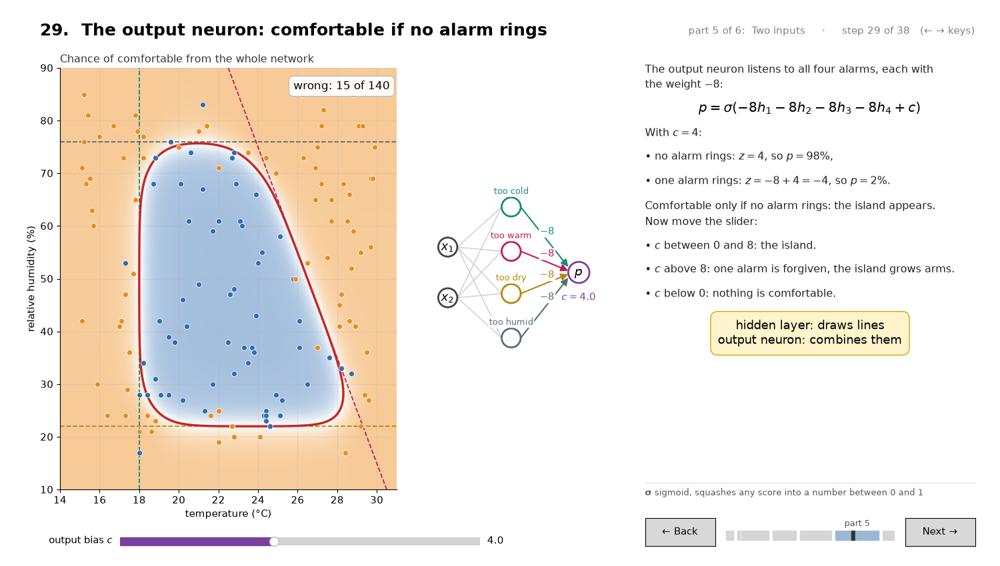
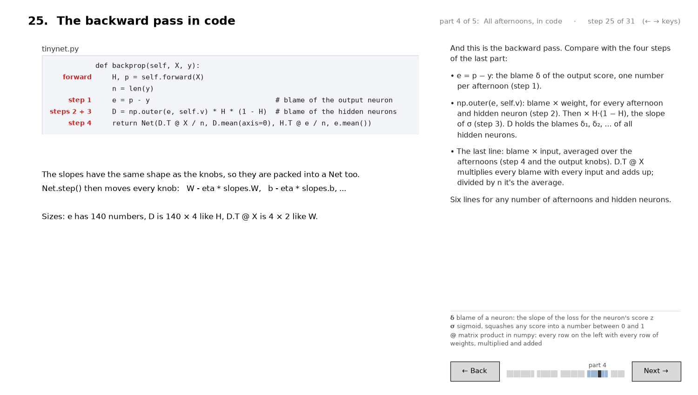

# Neural Network Demo

Two interactive step-by-step courses for beginners that show how a neural network works and how it learns, plus a
short scikit-learn script. The example throughout: an office where the staff vote at 3 pm whether the temperature and
humidity feel comfortable.

## Setup

```sh
python3 -m venv .venv
source .venv/bin/activate
pip install -r requirements.txt
```

Verified with Python 3.14 and 3.15.2 and the versions pinned in `requirements.txt`.

### Troubleshooting

After an upgrade of Python itself (for example with Homebrew), the environment in `.venv` can point to a Python that
no longer exists. Then commands fail with "bad interpreter", "no such file or directory" or "command not found:
python", or `python3` reports `No module named 'matplotlib'` (or `'numpy'`) although it was installed. Delete the
environment and repeat the three setup commands above:

```sh
deactivate                   # only if the environment is active
rm -rf .venv
```

## Run

```sh
python nn.py                 # the whole thing in ~100 lines with scikit-learn, prints results and shows a map
python nn_tutor.py           # course 1: neural networks, step by step (38 steps)
python backprop_tutor.py     # course 2: backpropagation, step by step (31 steps)
```

Take the courses in this order. Use the Back / Next buttons or the arrow keys, and play with the sliders and buttons.
Hover over symbols in the text for an explanation.

Options for both courses:

```sh
python nn_tutor.py --step 20        # open at step 20
python nn_tutor.py --save pages     # export every step as a PNG into the folder pages
```

An export names the files after the course: `nn_tutor_step_01.png`, `nn_tutor_step_02.png`, … and
`backprop_tutor_step_01.png`, …, so both courses can share one folder. Pages of the same course with higher step
numbers, left over from an earlier and longer version, are removed; other files in the folder stay.

## What the courses cover

**nn_tutor.py:** one neuron (weight, bias, sigmoid), hidden neurons working together, loss, slopes and gradient
descent, learning rate and random starts, two inputs, overfitting, the test on unseen data, ReLU and deeper networks.



**backprop_tutor.py:** slopes and the chain rule, one neuron backwards, a small network backwards with real numbers,
all examples at once with matrices and the actual numpy code, gradient checks, vanishing slopes in deep networks.



Every step of both courses is in the folder `pages`.

No maths beyond +, −, × and ÷ is assumed.

## Check

After changing a course, the shared code or `nn.py`, run the automated check from the project folder:

```sh
python -m unittest           # add -v to see every test
```

It opens no window and takes about half a minute. It opens every page of both courses and fails if a page raises an
error or its text does not fit. It also checks that `nn.py` and the courses use the same afternoons, that
backpropagation gives the same slopes as nudging every knob, and that the notes beside the code listings of course 2
still find their lines. A failing page is named by course, step number and title.

## Files

| File | Contents |
| --- | --- |
| `nn.py` | Standalone demo with scikit-learn's `MLPClassifier` |
| `nn_tutor.py` | Course 1 |
| `backprop_tutor.py` | Course 2 |
| `tinynet.py` | The data and a tiny neural network in plain numpy, used by both courses |
| `office.py` | Data as the courses show it, colours and plot helpers |
| `tutorkit.py` | The course window: pages, text panel, sliders, buttons, glossary popups |
| `tests/` | The automated check, see above |
| `pages/` | Every step of both courses as a PNG, made with `--save pages` |
